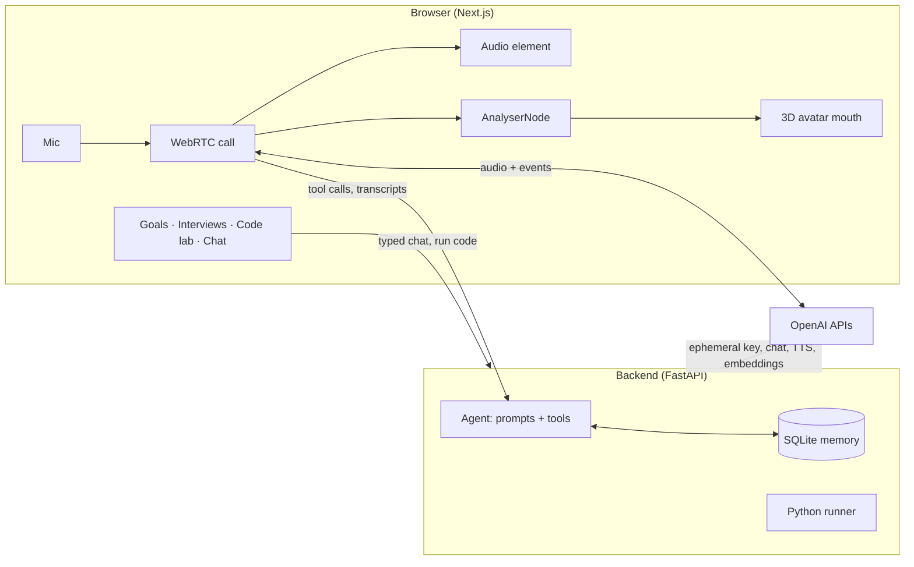

# Sensei: a 3D voice mentor

Sensei is a voice-first AI mentor with a 3D avatar. You talk to it like a phone call.
It remembers your goals, runs a daily check-in, holds you accountable, gives mock
interviews, and tutors you through LeetCode problems in a built-in Python editor.

- **Live voice calls**: just talk. Sensei notices when you've finished a thought,
  answers in under a second, and stops if you interrupt it.
- **Long-term memory**: facts about you, your goals, and your progress are stored
  locally and recalled when they're relevant.
- **Accountability**: daily check-ins compare what you committed to with what you did.
- **Mock interviews**: AI-generated DSA and behavioral questions, scored for clarity
  and correctness, with weak topics tracked over time.
- **Code lab**: a Monaco Python editor with Run, a LeetCode tracker with spaced
  review, and a tutor that sees your code and gives hints, not answers.
- **Lip-synced avatar**: a procedural 3D head whose mouth follows Sensei's voice.

## How it works



- **Live calls** use the OpenAI Realtime API over WebRTC. Audio goes from the browser
  straight to OpenAI using a short-lived key minted by the backend, so your API key
  never reaches the browser. When the model calls a tool (save a memory, score an
  answer, log a problem), the browser forwards it to the backend, which runs it
  against the database.
- **Typed chat** goes through the backend: a streaming tool-calling agent, with each
  sentence converted to speech as soon as it's finished.
- **Memory** is a local SQLite file: facts (with embeddings for semantic recall),
  goals, progress, chat history, interview scores, and LeetCode problems.

## Quick start

### Requirements

- Python **3.10+** (macOS's built-in Python 3.9 is too old)
- Node.js **18+**
- An [OpenAI API key](https://platform.openai.com/api-keys) with some credit. One key
  covers everything: chat, speech, transcription, embeddings, and Realtime.

### 1. Backend

```bash
cd backend
conda create -n sensei python=3.11 -y && conda activate sensei
# or: python3.11 -m venv .venv && source .venv/bin/activate
pip install -r requirements.txt
cp .env.example .env        # then set OPENAI_API_KEY and SENSEI_USER_NAME
uvicorn main:app --reload --port 8000
```

Check it's up: `curl localhost:8000/api/health` should print `{"ok":true,...}`.

### 2. Frontend

```bash
cd frontend
npm install
cp .env.local.example .env.local
npm run dev
```

Open http://localhost:3000 in Chrome.

## Using Sensei

1. Click **Start session**. Browsers only allow audio after a click. If you haven't
   checked in today, Sensei opens with a check-in.
2. **Tap the mic to start a call** and allow microphone access. Then just talk.
   Tap again to hang up. You can also type in the box, during a call or without one.
3. **Set goals by talking**: "I want to solve 5 LeetCode mediums a week." Sensei
   creates the goal, logs progress when you report it, and brings it up at check-in.
4. **Mock interview**: click **DSA**, **Behavioral** or **Mixed** in the side panel,
   or say "let's do a mock interview." Click **End** or say you want to stop.
5. **Code lab**: click **</> Code** to open the editor.
   - Paste the problem statement, write your solution, and press **▶ Run** (⌘↵).
   - **Save** (⌘S) stores it in your tracker with difficulty, topic, status and
     confidence.
   - Use **Hint**, **Review** or **Explain error**, or just ask out loud.
   - Solved problems come back for review after 1 to 30 days, sooner if your
     confidence was low. Due reviews appear in the **LeetCode** card.

Use headphones if you can: Sensei is less likely to hear its own voice and stop
mid-sentence.

## Configuration

All settings live in `backend/.env`. Only `OPENAI_API_KEY` is required.

| Variable | Default | What it does |
|---|---|---|
| `OPENAI_API_KEY` | none | Your OpenAI key (required) |
| `SENSEI_USER_NAME` | `friend` | What Sensei calls you |
| `OPENAI_REALTIME_MODEL` | `gpt-realtime-2.1` | Model for live calls |
| `OPENAI_REALTIME_VOICE` | `marin` | Call voice: `marin`, `cedar`, `ash`, `sage`, `coral`, `verse`… |
| `OPENAI_REALTIME_STT_MODEL` | `gpt-4o-mini-transcribe` | Transcribes your side of the call for history |
| `REALTIME_VAD_EAGERNESS` | `auto` | How quickly it replies when you pause: `low`, `medium`, `high`, `auto` |
| `REALTIME_NOISE_REDUCTION` | `far_field` | `far_field` for laptop mics, `near_field` for headsets |
| `OPENAI_CHAT_MODEL` | `gpt-4o-mini` | Model for typed chat |
| `OPENAI_TTS_MODEL` / `OPENAI_TTS_VOICE` | `tts-1` / `onyx` | Speech for typed-chat replies |
| `OPENAI_STT_MODEL` | `whisper-1` | Transcription for the `/api/talk` endpoint |
| `OPENAI_EMBED_MODEL` | `text-embedding-3-small` | Embeddings for memory recall |
| `SENSEI_DB` | `sensei.db` | SQLite file path |
| `CORS_ORIGINS` | `http://localhost:3000` | Allowed frontend origins, comma-separated |

The frontend has one setting, `NEXT_PUBLIC_API_URL` in `frontend/.env.local`
(default `http://localhost:8000`).

## Project structure

```
sensei/
├── backend/
│   ├── main.py          # FastAPI app: endpoints, streaming, Realtime keys, code runner
│   ├── agent.py         # Prompts (mentor, interviewer, tutor), tools, tool-calling loop
│   ├── memory.py        # SQLite: memories, goals, progress, messages, interviews, problems
│   └── requirements.txt
└── frontend/
    ├── app/page.tsx     # Main UI and state: calls, chat, panels
    ├── components/
    │   ├── Scene.tsx    # Three.js canvas and lights
    │   ├── Avatar.tsx   # Procedural head with lip-sync, blinking, status halo
    │   └── CodeLab.tsx  # Monaco editor, run output, LeetCode problem form
    └── lib/
        ├── api.ts         # Typed API client and NDJSON stream reader
        └── useRealtime.ts # WebRTC live call: events, tools, transcripts
```

## API

| Method | Path | Purpose |
|---|---|---|
| GET | `/api/health` | Health check |
| POST | `/api/chat` | `{text, context?}` → streamed reply (NDJSON) |
| POST | `/api/talk` | Audio file → transcribed, then streamed reply (NDJSON) |
| GET / POST | `/api/checkin` | Is today's check-in due / run it (streamed) |
| POST | `/api/realtime/session` | Mint a short-lived key and session config for a live call |
| POST | `/api/realtime/instructions` | Fresh instructions (memories, goals, mode, code) for a live call |
| POST | `/api/realtime/tool` | Run a tool the live model called |
| POST | `/api/realtime/log` | Save a call transcript line to history |
| GET | `/api/interview` | Active mock interview and per-topic scores, weakest first |
| POST | `/api/interview/start` | `{kind: dsa \| behavioral \| mixed}` → streamed first question |
| POST | `/api/interview/end` | Streamed wrap-up |
| POST | `/api/run` | `{code}` → run Python (10s limit) → `{stdout, stderr, exit_code, ms}` |
| GET / POST | `/api/problems` | LeetCode tracker: list with stats and due reviews / create or update |
| DELETE | `/api/problems/{id}` | Delete a problem |
| GET | `/api/goals` | Active goals with 7-day progress |
| GET | `/api/history` | Recent conversation |

Streamed replies are newline-delimited JSON events: `transcript`, then `delta` text
chunks as the reply is written, then `audio` (base64 MP3, one per sentence), plus
`error` if something fails.

## Costs and safety

- **Live calls cost more per minute than typed chat.** Check OpenAI's pricing for
  your Realtime model and watch your usage dashboard.
- **`/api/run` executes any Python code on your machine** with the backend's
  interpreter, including code that reads or deletes files. That's fine for a local
  app you use yourself. Never deploy the backend publicly without sandboxing it.
- **Your data stays local** in `backend/sensei.db`, except for what is sent to OpenAI
  to generate replies. `.env` and `*.db` are gitignored.

## Troubleshooting

| Problem | Fix |
|---|---|
| "Can't reach the Sensei backend" | Start the backend on port 8000 and check `curl localhost:8000/api/health`. |
| `TypeError: unsupported operand type(s) for \|` on startup | Your Python is older than 3.10. Use the conda or venv steps above. |
| Mic button does nothing, or "Couldn't start the call" | Allow microphone access for localhost in Chrome's site settings. |
| Sensei stops mid-sentence by itself | It's hearing its own voice. Use headphones, or set `REALTIME_VAD_EAGERNESS=low`. |
| It answers before you've finished | Set `REALTIME_VAD_EAGERNESS=low`. If it's too slow, use `high`. |
| "Realtime session failed" | Check your API key and credit. The full OpenAI error is included in the message. |
| Changed the database schema | No migrations yet. Delete `backend/sensei.db` (this erases your data) or migrate by hand. |

## Roadmap

- **Real avatar**: a Ready Player Me model with viseme-driven lip-sync.
- **Weekly review**: a Sunday report of wins, misses and streaks.
- **Personas**: a strict DSA coach, a startup advisor and a calm reflection guide,
  each with its own voice and look.
- **Screen-aware coaching**: share a screenshot and debug together.
- **Integrations**: GitHub commits, Google Calendar, Gmail and a job tracker as tools,
  so progress is verified rather than self-reported.
- **Proactive nudges**: a push notification when you skip a check-in.

## Tech stack

**Frontend:** Next.js 14, React 18, TypeScript, React Three Fiber, Monaco Editor, WebRTC, Web Audio
**Backend:** FastAPI, SQLite, NumPy, OpenAI Python SDK
**AI:** OpenAI Realtime API, Chat Completions with tool calling, TTS, transcription, embeddings
